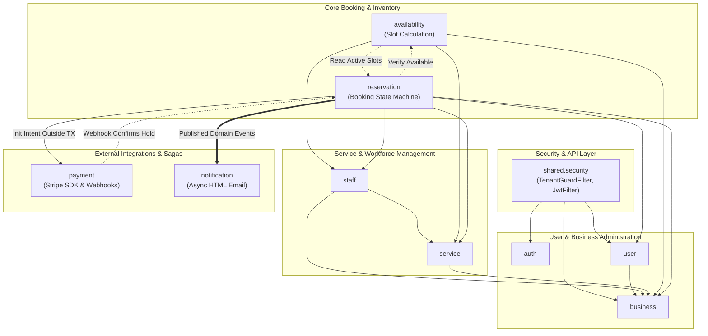
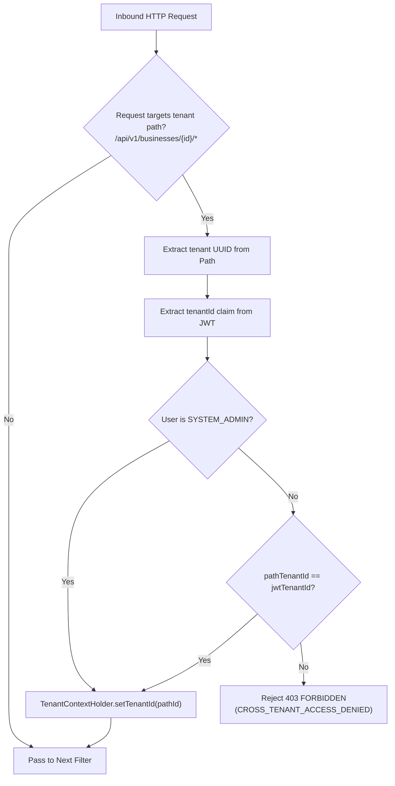
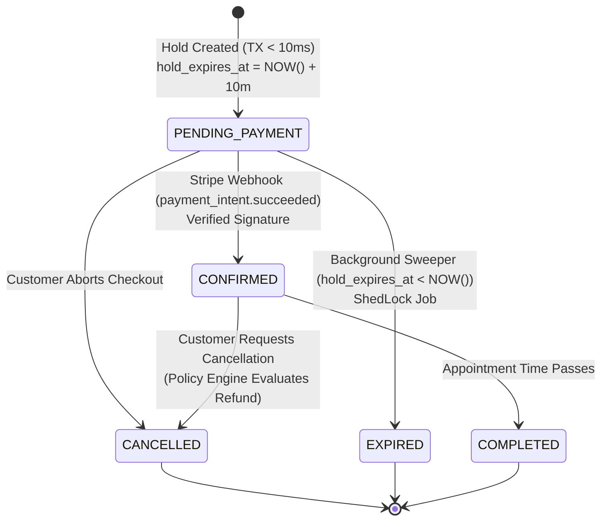
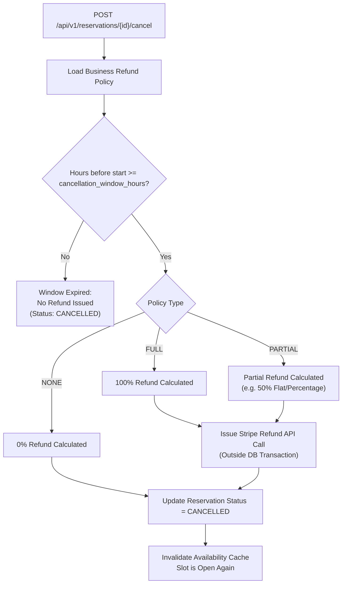
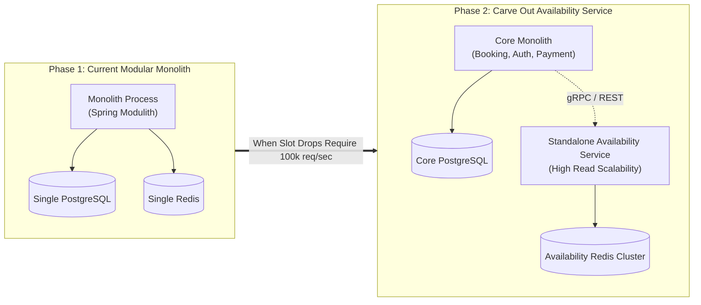

# System Architecture Specification

[](https://spring.io/projects/spring-modulith)
[](https://openjdk.org/projects/jdk/21/)
[](https://spring.io/projects/spring-boot)
[](https://spring.io/projects/spring-modulith)
[](https://www.postgresql.org/)
[](https://redis.io/)

> **Project:** [Online Reservation System](https://github.com/istiakahasan/Online_Reservation_System)  
> **Document Status:** Active / Authoritative Architectural Baseline  
> **Related ADR:** [docs/adr/ADR-001-core-architecture.md](file:///docs/adr/ADR-001-core-architecture.md)

---

## Table of Contents

- [1. Architectural Principles & Philosophy](#1-architectural-principles--philosophy)
- [2. Domain Decomposition & Bounded Contexts](#2-domain-decomposition--bounded-contexts)
  - [2.1 Bounded Context Inventory](#21-bounded-context-inventory)
  - [2.2 Inter-Module Dependency Graph](#22-inter-module-dependency-graph)
  - [2.3 Package-by-Feature Encapsulation](#23-package-by-feature-encapsulation)
- [3. Multi-Tenancy & Data Isolation Model](#3-multi-tenancy--data-isolation-model)
  - [3.1 Storage Strategy: Shared Database with Tenant Discriminator](#31-storage-strategy-shared-database-with-tenant-discriminator)
  - [3.2 Tenant Context & Request Scoping](#32-tenant-context--request-scoping)
  - [3.3 Security Perimeter: TenantGuardFilter](#33-security-perimeter-tenantguardfilter)
- [4. Concurrency Model & Double-Booking Prevention](#4-concurrency-model--double-booking-prevention)
  - [4.1 The "Hot Slot" Concurrency Problem](#41-the-hot-slot-concurrency-problem)
  - [4.2 Two-Tier Defense Architecture](#42-two-tier-defense-architecture)
  - [4.3 Idempotency Guarantees](#43-idempotency-guarantees)
- [5. Decoupled 2-Phase Hold & Stripe Payment Saga](#5-decoupled-2-phase-hold--stripe-payment-saga)
  - [5.1 The Anti-Pattern: External Network Calls Inside Relational Transactions](#51-the-anti-pattern-external-network-calls-inside-relational-transactions)
  - [5.2 Two-Phase Hold State Machine](#52-two-phase-hold-state-machine)
  - [5.3 Webhook Reconciliation & Signature Verification](#53-webhook-reconciliation--signature-verification)
  - [5.4 Cancellation & Refund Policy Engine](#54-cancellation--refund-policy-engine)
- [6. Asynchronous Event-Driven Architecture (Transactional Outbox)](#6-asynchronous-event-driven-architecture-transactional-outbox)
  - [6.1 Spring Modulith Event Publication Registry](#61-spring-modulith-event-publication-registry)
  - [6.2 Elimination of Premature Message Broker Overhead](#62-elimination-of-premature-message-broker-overhead)
- [7. Distributed Scheduling & Background Workers](#7-distributed-scheduling--background-workers)
  - [7.1 ShedLock JDBC Table Mutex](#71-shedlock-jdbc-table-mutex)
  - [7.2 Stale Hold Reclaim Sweeper](#72-stale-hold-reclaim-sweeper)
- [8. Observability, Telemetry & Operational Health](#8-observability-telemetry--operational-health)
  - [8.1 Structured MDC Request Correlation](#81-structured-mdc-request-correlation)
  - [8.2 OpenTelemetry Tracing Pipeline](#82-opentelemetry-tracing-pipeline)
  - [8.3 Metrics Topology & Prometheus Scraping](#83-metrics-topology--prometheus-scraping)
  - [8.4 Actuator Probes (Liveness & Readiness)](#84-actuator-probes-liveness--readiness)
- [9. Frontend Client Architecture & State Machine](#9-frontend-client-architecture--state-machine)
  - [9.1 Next.js 14 App Router & Route Groups](#91-nextjs-14-app-router--route-groups)
  - [9.2 TanStack Query v5 Optimistic Booking State Machine](#92-tanstack-query-v5-optimistic-booking-state-machine)
  - [9.3 Centralized Auth Interceptor & Transparent 401 Token Refresh](#93-centralized-auth-interceptor--transparent-401-token-refresh)
- [10. Security Architecture & Threat Model](#10-security-architecture--threat-model)
- [11. Evolutionary Architecture: Path to Microservices](#11-evolutionary-architecture-path-to-microservices)

---

## 1. Architectural Principles & Philosophy

The Online Reservation System is designed according to **Modular Monolith** principles, prioritizing high domain cohesion, deep technical encapsulation, extreme runtime throughput, and minimal operational overhead.

```text
                  +----------------------------------------------+
                  |           Spring Modulith Monolith           |
                  |                                              |
                  |   [Auth]      [Business]      [User]         |
                  |                                              |
                  |   [Service]   [Staff]         [Availability] |
                  |                                              |
                  |   [Reservation]  [Payment]    [Notification] |
                  +----------------------------------------------+
                                  |              |
                                  v              v
                           +------------+  +-----------+
                           | PostgreSQL |  |  Redis 7  |
                           +------------+  +-----------+
```

### Core Tenets

1. **Modular Monolith over Microservices:**  
   Microservices introduce substantial operational tax: network serialization latency, cross-service schema migrations, distributed tracing overhead, and complex Two-Phase Commit / Saga orchestrations. For small-to-medium engineering teams, a Modular Monolith built with **Spring Modulith 1.2+** provides identical domain boundary isolation without the operational burden.
2. **Compile-Time & Test-Time Architectural Verification:**  
   Module dependencies are strictly unidirectional and verified continuously in unit tests via ArchUnit (`ApplicationModules.of(...).verify()`). Domain bleed and illegal circular dependencies cause immediate build failures.
3. **Decoupled Transactions & Zero External I/O in Relational Transactions:**  
   External API calls (e.g. Stripe, SMTP, Twilio) are strictly prohibited inside database transactions (`@Transactional`). This completely eliminates HikariCP database connection starvation caused by third-party latency.
4. **Hybrid Inter-Module Communication:**  
   - **Synchronous Direct Calls:** Used strictly for read-only queries and invariant pre-condition checks via public module interfaces/facades.
   - **Asynchronous Domain Events:** Used for all state transitions and side effects via the Spring Modulith Transactional Event Publication Registry.
5. **Java 21 Virtual Threads (Project Loom):**  
   The application leverages lightweight Virtual Threads (`spring.threads.virtual.enabled=true`) for non-blocking concurrent request handling, allowing thousands of simultaneous waiting connections without thread-pool exhaustion.

---

## 2. Domain Decomposition & Bounded Contexts

### 2.1 Bounded Context Inventory

The platform is split into 9 distinct business modules and 1 cross-cutting shared infrastructure package under `com.example.reservation`:

| Module | Architectural Role | Key Responsibilities & Invariants | Exported Facade / API |
| :--- | :--- | :--- | :--- |
| **`auth`** | Security & Identity | Issues HMAC-SHA256 JWT access tokens (15m TTL), manages refresh token rotation (7d TTL), and performs BCrypt password hashing. | `JwtService` |
| **`business`** | Multi-Tenant Management | Manages business entity profiles, unique URL slugs, operating hours, and timezones (`java.time.ZoneId`). | `BusinessService`, `BusinessRepository` |
| **`user`** | Identity & Access | Manages user profiles across roles (`CUSTOMER`, `STAFF`, `OWNER`, `SYSTEM_ADMIN`) partitioned by tenant. | `UserService`, `UserRepository` |
| **`service`** | Catalog Management | Manages bookable service offerings, base durations, buffer times, pricing, and currency codes. | `ServiceCatalogService` |
| **`staff`** | Workforce Management | Manages staff member profiles, assigned services, weekly working hours, and custom schedule exceptions. | `StaffService`, `StaffScheduleRepository` |
| **`availability`**| Inventory Engine | Calculates real-time slot availability by evaluating business hours, staff rosters, buffer times, and existing bookings. Uses Redis cache-aside. | `AvailabilityService`, `AvailabilityEngine` |
| **`reservation`** | Core Booking Domain | Orchestrates the booking state machine (`PENDING_PAYMENT` -> `CONFIRMED` / `CANCELLED` / `EXPIRED`), Redisson mutex locking, and cancellation policies. | `ReservationService`, `CancelReservationUseCase` |
| **`payment`** | Stripe Gateway Saga | Creates Stripe PaymentIntents outside database transactions, verifies webhook signatures, and handles policy-based refunds. | `StripeService` |
| **`notification`**| Asynchronous Messaging | Listens to domain events (`BookingConfirmedEvent`, etc.) and asynchronously renders and dispatches Thymeleaf HTML confirmation emails. | `NotificationEventListener` |
| **`shared`** | Cross-Cutting Concerns | Global exception handling, OpenAPI config, MDC logging filter, Micrometer metrics, TenantGuard, and Security configuration. | `TenantContextHolder`, `ReservationMetrics` |

---

### 2.2 Inter-Module Dependency Graph

The following Mermaid diagram visualizes the structural dependency relationships between bounded contexts. Notice that all dependencies flow inward or follow asynchronous event pathways; there are **zero circular dependencies**:



---

### 2.3 Package-by-Feature Encapsulation

In adherence to [Project standards.md](file:///Project%20standards.md), code is organized **by feature, not by technical layer**:

```text
com.example.reservation.<feature>/
├── api/
│   ├── <Feature>Controller.java        # REST API endpoints (@RestController)
│   ├── <Feature>RequestDto.java        # Immutable incoming request records
│   └── <Feature>ResponseDto.java       # Immutable outgoing response records
├── service/
│   ├── <Feature>Service.java           # Public domain service interface
│   └── <Feature>ServiceImpl.java       # Internal implementation
├── domain/
│   ├── <Feature>Entity.java            # JPA entity (package-private constructors)
│   ├── <Feature>Status.java            # Domain value objects / enums
│   └── policy/                         # Domain rule policies (e.g. CancellationPolicy)
├── repo/
│   └── <Feature>Repository.java        # Spring Data JPA repository
└── mapper/
    └── <Feature>Mapper.java            # MapStruct / explicit entity-to-DTO mapper
```

**Key Encapsulation Rules:**
* JPA entities are never exposed across API boundaries. They are strictly converted to immutable Java `record` DTOs.
* No entity field-level validation: `jakarta.validation.constraints` annotations are strictly placed on DTO records, keeping entities focused on domain invariants and relational mappings.
* No circular imports between features: inter-module queries use exported Service interfaces; side-effects use domain events.

---

## 3. Multi-Tenancy & Data Isolation Model

### 3.1 Storage Strategy: Shared Database with Tenant Discriminator

The platform adopts the **Shared Database, Shared Schema (Discriminator Column)** architectural pattern. Every business-owned entity table (`users`, `services`, `staff`, `reservations`, `business_hours`, etc.) contains a mandatory, indexed foreign key column:

```sql
business_id UUID NOT NULL REFERENCES businesses(id) ON DELETE CASCADE
```

#### Rationale for Shared Database Architecture
* **Resource Efficiency:** A small team managing hundreds or thousands of businesses cannot justify the cost, migration latency, and connection-pool overhead of dedicated PostgreSQL databases per tenant.
* **Unified Connection Management:** A single HikariCP connection pool serves all tenants efficiently.
* **Cross-Tenant Safety:** Guarded by robust application-level security filters and compound unique database constraints.

---

### 3.2 Tenant Context & Request Scoping

The active tenant identity is tracked within a thread-safe context container backed by `ThreadLocal` in [TenantContextHolder.java](file:///src/main/java/com/example/reservation/shared/security/TenantContextHolder.java):

```java
public final class TenantContextHolder {
    private static final ThreadLocal<UUID> CURRENT_TENANT = new ThreadLocal<>();

    public static void setTenantId(UUID tenantId) {
        CURRENT_TENANT.set(tenantId);
    }

    public static UUID getTenantId() {
        return CURRENT_TENANT.get();
    }

    public static void clear() {
        CURRENT_TENANT.remove();
    }
}
```

---

### 3.3 Security Perimeter: TenantGuardFilter

The [TenantGuardFilter.java](file:///src/main/java/com/example/reservation/shared/security/TenantGuardFilter.java) executes early in the Spring Security filter chain for every incoming HTTP request:



1. **Path Variable Verification:** If a URL targets `/api/v1/businesses/{tenantId}`, the filter extracts the target UUID.
2. **Token Claim Comparison:** It compares the path UUID against the authenticated user's `tenantId` claim stored in the JWT.
3. **Cross-Tenant Rejection:** If a user belonging to Tenant A attempts to read or mutate resources for Tenant B, the request is immediately halted with `403 FORBIDDEN` and error code `CROSS_TENANT_ACCESS_DENIED`.
4. **Header Overwrite Protection:** Optional `X-Tenant-ID` headers are strictly checked to ensure they match the authenticated JWT token context.

---

## 4. Concurrency Model & Double-Booking Prevention

### 4.1 The "Hot Slot" Concurrency Problem

In appointment and reservation systems, high-demand venues release availability in synchronized drop windows (e.g. daily at 09:00 AM or midnight). Under these conditions, hundreds of customers click "Book" on the exact same 19:00 Friday table within the same 50-millisecond window.

Relying exclusively on relational row-level locking (`SELECT ... FOR UPDATE`) under spiky burst traffic causes:
1. Massive connection pool contention on HikariCP.
2. Database CPU spikes caused by lock queue management.
3. High transaction abort and deadlock rates.

---

### 4.2 Two-Tier Defense Architecture

The platform mitigates lock contention by employing a **Two-Tier Defense**:

```text
               Concurrent Booking Requests (Thread 1 to N)
                                   |
                                   v
             +-------------------------------------------+
             |   Tier 1: Redisson Distributed Lock       |  (Sub-millisecond Mutex in Redis)
             |   Key: "lock:slot:{businessId}:{slotId}"  |  (Absorbs 99% of Race Contention)
             +-------------------------------------------+
                                   |
                          (Lock Winner Only)
                                   |
                                   v
             +-------------------------------------------+
             |   Tier 2: PostgreSQL ACID State Check     |  (Pessimistic Hold Insertion)
             |   Unique Constraint: business_id, staff_id|  (Ultimate Safety Net)
             |   status NOT IN ('CANCELLED', 'EXPIRED')  |
             +-------------------------------------------+
```

#### Tier 1: Redisson Distributed Mutex Locking
* **Lock Key:** `lock:slot:{businessId}:{slotId}` (where `slotId` is a hash of `staffId + startTime + endTime`).
* **Wait Time:** 500 milliseconds (clients queue briefly for the mutex).
* **Lease Time:** 3 seconds (automatic lock release prevents permanent deadlocks if a container node crashes).
* **Benefit:** 99% of colliding concurrent requests are rejected or serialized in Redis memory before touching PostgreSQL database connections.

#### Tier 2: PostgreSQL Constraint Safety Net
Even in the extreme event of a Redis node failover or expired lease timeout, PostgreSQL enforces an exclusion or unique index constraint on the `reservations` table:

```sql
CREATE UNIQUE INDEX idx_reservations_prevent_double_book 
ON reservations (business_id, staff_id, start_time) 
WHERE status IN ('PENDING_PAYMENT', 'CONFIRMED');
```

If two transactions ever attempt to commit an overlapping active hold or confirmed booking for the same staff member, PostgreSQL raises a `unique_violation` (SQLSTATE `23505`), which the application safely translates into a `409 CONFLICT` (`SLOT_ALREADY_RESERVED`).

---

### 4.3 Idempotency Guarantees

Every mutation endpoint supports an `Idempotency-Key` HTTP header. 
* Upon receiving a hold request with key `idemp_abc123`, the system records the key in Redis with a 24-hour TTL.
* Duplicate incoming requests with the same key immediately return the cached reservation result without acquiring locks or re-executing booking logic.

---

## 5. Decoupled 2-Phase Hold & Stripe Payment Saga

### 5.1 The Anti-Pattern: External Network Calls Inside Relational Transactions

A common failure mode in booking engines is executing payment gateway calls inside database transactions:

```java
// SEVERE ANTI-PATTERN (DO NOT DO THIS)
@Transactional
public Reservation confirmBooking(BookingRequest req) {
    Reservation r = reservationRepo.save(new Reservation(...)); // Pinned DB Connection!
    stripeService.chargeCard(req.paymentToken());              // Takes 500ms - 2500ms!
    r.setStatus(CONFIRMED);
    return reservationRepo.save(r);
}
```

Under 100 concurrent requests, a HikariCP pool of 20 connections is depleted in less than 50 milliseconds. The entire application becomes unresponsive to all tenants.

---

### 5.2 Two-Phase Hold State Machine

The platform resolves this using a **Decoupled Two-Phase Hold State Machine**:



#### Detailed Phase Execution

1. **Phase 1: Fast Hold Creation (`PENDING_PAYMENT`)**
   - Acquire Redisson slot mutex.
   - Begin short database transaction (< 10ms).
   - Verify slot is unbooked.
   - Insert reservation with status `PENDING_PAYMENT` and `hold_expires_at = Instant.now().plus(Duration.ofMinutes(10))`.
   - Commit database transaction.
   - Release Redisson mutex.
   - **Database connection is returned to pool.**

2. **Phase 2: PaymentIntent Generation (Outside Transaction)**
   - Call Stripe API: `PaymentIntent.create(...)`.
   - Embed internal `reservation_id` and `tenant_id` inside Stripe metadata.
   - Return Stripe `client_secret` to client browser.

3. **Phase 3: Client Checkout & Webhook Confirmation**
   - Client confirms payment via Stripe Elements in browser.
   - Stripe asynchronously dispatches signed webhook event `payment_intent.succeeded`.

4. **Phase 4: Webhook Reconciliation**
   - Verify webhook HMAC-SHA256 signature using `STRIPE_WEBHOOK_SECRET`.
   - Begin short database transaction.
   - Verify hold has not expired.
   - Transition status to `CONFIRMED`.
   - Publish `BookingConfirmedEvent` to Spring Modulith Event Registry.
   - Commit transaction and return `200 OK` to Stripe.

---

### 5.3 Webhook Reconciliation & Signature Verification

In [StripeWebhookController.java](file:///src/main/java/com/example/reservation/payment/api/StripeWebhookController.java):
* The raw payload bytes and `Stripe-Signature` header are verified using Stripe's `Webhook.constructEvent()`.
* **Idempotency Protection:** Webhook event IDs (e.g. `evt_1N...`) are checked against the `stripe_events` database table. Replay attempts are acknowledged immediately with `200 OK` without duplicate processing.

---

### 5.4 Cancellation & Refund Policy Engine

When a customer or business cancels a booking, the [CancellationPolicy](file:///src/main/java/com/example/reservation/reservation/domain/policy/CancellationPolicy.java) interface determines the refund eligibility:



---

## 6. Asynchronous Event-Driven Architecture (Transactional Outbox)

### 6.1 Spring Modulith Event Publication Registry

To deliver auxiliary side effects (customer email notifications, metric increments, audit logging) without coupling transactions or risking data inconsistency, the application utilizes the **Spring Modulith Event Publication Registry**:

```text
Database Transaction (PostgreSQL)
+-------------------------------------------------------------------+
| 1. UPDATE reservations SET status = 'CONFIRMED'                   |
| 2. applicationEventPublisher.publishEvent(new BookingConfirmed..) |
|    └─> Modulith intercepts event:                                 |
|        INSERT INTO event_publication (id, event_type, payload...)  |
| 3. COMMIT TRANSACTION                                             |
+-------------------------------------------------------------------+
                               |
                   (Asynchronous Dispatcher)
                               |
                               v
+-------------------------------------------------------------------+
| @ApplicationModuleListener (NotificationEventListener)            |
| 1. Deserializes BookingConfirmedEvent                             |
| 2. Renders HTML email via Thymeleaf                               |
| 3. Sends email via JavaMailSender (MailHog/SMTP)                  |
| 4. Marks event as completed in event_publication table            |
+-------------------------------------------------------------------+
```

### 6.2 Elimination of Premature Message Broker Overhead

By storing unpublished events directly inside PostgreSQL's `event_publication` table:
* Events are committed **atomically** with the reservation record (guaranteeing the Transactional Outbox pattern).
* If the application crashes before an event listener completes, Spring Modulith automatically retries publishing upon container startup.
* Eliminates the operational complexity, network overhead, and maintenance costs of managing Kafka, RabbitMQ, or AWS SQS.

---

## 7. Distributed Scheduling & Background Workers

### 7.1 ShedLock JDBC Table Mutex

In horizontally scaled deployments (e.g. multiple Kubernetes pods or container replicas), scheduled jobs annotated with `@Scheduled` would execute simultaneously on all instances, causing duplicate sweeps and database race conditions.

The platform integrates **ShedLock 5.16** backed by PostgreSQL JDBC Template:

```sql
CREATE TABLE shedlock (
    name VARCHAR(64) PRIMARY KEY,
    lock_until TIMESTAMP WITH TIME ZONE NOT NULL,
    locked_at TIMESTAMP WITH TIME ZONE NOT NULL,
    locked_by VARCHAR(255) NOT NULL
);
```

### 7.2 Stale Hold Reclaim Sweeper

In [ReservationScheduledJobs.java](file:///src/main/java/com/example/reservation/reservation/jobs/ReservationScheduledJobs.java):
* Sweeps every 60 seconds with `@SchedulerLock(name = "expireStaleHolds", lockAtMostFor = "30s")`.
* Executes query:
  ```sql
  SELECT * FROM reservations 
  WHERE status = 'PENDING_PAYMENT' AND hold_expires_at < NOW() 
  FOR UPDATE SKIP LOCKED;
  ```
* Updates status to `EXPIRED`, releasing inventory back to the availability pool.

---

## 8. Observability, Telemetry & Operational Health

### 8.1 Structured MDC Request Correlation

The [MdcLoggingFilter.java](file:///src/main/java/com/example/reservation/shared/observability/MdcLoggingFilter.java) guarantees that every log output in the application includes standardized correlation tokens:

* `requestId`: Unique UUID identifying the specific HTTP request.
* `tenantId`: Active tenant UUID or `none`.
* `userId`: Authenticated user UUID or `anonymous`.
* `traceId` & `spanId`: W3C distributed trace tokens generated by OpenTelemetry.

### 8.2 OpenTelemetry Tracing Pipeline

Tracing is configured natively via `micrometer-tracing-bridge-otel` and exported via OTLP (`opentelemetry-exporter-otlp`):
* Samples 100% of traces (`management.tracing.sampling.probability=1.0`).
* Spans are propagated automatically across HTTP Controller -> Service -> Repository boundaries.
* Outgoing HTTP calls (Stripe SDK) and asynchronous events inherit parent trace contexts.

### 8.3 Metrics Topology & Prometheus Scraping

The platform registers custom business metrics via Micrometer in [ReservationMetrics.java](file:///src/main/java/com/example/reservation/shared/observability/ReservationMetrics.java):

```text
/actuator/prometheus
├── booking_success_total{business_id="...", service_id="..."}
├── booking_conflict_total{reason="lock_contention|db_constraint|expired_hold"}
├── payment_failure_total{failure_code="card_declined|expired_card"}
├── availability_latency_seconds_bucket{le="0.05", ...}
└── active_reservations{tenant_id="..."}
```

### 8.4 Actuator Probes (Liveness & Readiness)

Configured in [HealthCheckController.java](file:///src/main/java/com/example/reservation/shared/observability/HealthCheckController.java):
* **Liveness Probe (`/health`):** Verifies the JVM process is alive and responsive.
* **Readiness Probe (`/ready`):** Actively tests PostgreSQL (`SELECT 1`), Redis (`ping()`), and Stripe API reachable status. Returns `503 SERVICE_UNAVAILABLE` if any subsystem is degraded, preventing load balancers from routing traffic to unready pods.

---

## 9. Frontend Client Architecture & State Machine

### 9.1 Next.js 14 App Router & Route Groups

The frontend is structured into isolated Next.js 14 Route Groups:
* `/app/(customer)/book`: Customer-facing public booking wizard.
* `/app/(business)/dashboard`: Tenant administrative portal for managing staff, services, and schedules.
* `/lib/api`: Type-safe TypeScript API client generated directly from OpenAPI 3.0 spec.

### 9.2 TanStack Query v5 Optimistic Booking State Machine

The customer booking wizard utilizes TanStack Query v5:
1. **Optimistic Slot Hold:** When the user clicks "Proceed to Payment", the client immediately transitions the selected slot to a "held" visual state.
2. **Conflict Rollback:** If the backend returns `409 CONFLICT`, the optimistic update is rolled back automatically, refreshing available slots and alerting the user without a full page reload.
3. **Timezone Awareness:** Slots are displayed in the customer's local timezone alongside the venue's declared business timezone (`java.time.ZoneId`).

### 9.3 Centralized Auth Interceptor & Transparent 401 Token Refresh

In [interceptor.ts](file:///frontend/lib/auth/interceptor.ts):
* Inbound requests automatically attach `Authorization: Bearer <accessToken>`.
* If a request receives a `401 UNAUTHORIZED`, the interceptor buffers failing requests in an asynchronous queue, executes a single refresh call to `/api/v1/auth/refresh`, updates the token store, and retries all queued requests seamlessly.

---

## 10. Security Architecture & Threat Model

| Threat / Attack Vector | Mitigation Architecture | Verification Mechanism |
| :--- | :--- | :--- |
| **Cross-Tenant Data Tampering** | `TenantGuardFilter` enforces strict equality between path tenant UUID and authenticated JWT claims. | [SecurityIntegrationTest.java](file:///src/test/java/com/example/reservation/shared/security/SecurityIntegrationTest.java) |
| **JWT Signature Forgery** | HMAC-SHA256 signing with 256-bit secret. Expired or tampered tokens are rejected before controller invocation. | SecurityIntegrationTest (`tamperedJwtSignatureRejected`) |
| **SQL Injection Probes** | Strictly parameterized JPA queries and explicit `UUID` type coercion on path parameters. | SecurityIntegrationTest (`sqlInjectionProbeInPathVariableFailsSafely`) |
| **Stripe Webhook Spoofing** | HMAC-SHA256 signature verification of `Stripe-Signature` header via Stripe SDK. | [StripeWebhookControllerTest.java](file:///src/test/java/com/example/reservation/payment/api/StripeWebhookControllerTest.java) |
| **Replay Attacks on Webhooks** | `stripe_events` database table records and deduplicates event IDs atomically. | StripeWebhookControllerTest (`duplicateWebhookIgnored`) |
| **Rate-Limiting & Scraping** | Redis sliding-window rate limiting throttles abusive IP and tenant requests. | Redisson rate-limiting Lua scripts |

---

## 11. Evolutionary Architecture: Path to Microservices

Because module boundaries are strictly enforced via Spring Modulith, extracting a high-traffic bounded context into an independent microservice is straightforward:



1. **Extraction Candidate: Availability Engine:** Slot calculation queries outnumber booking mutations 50:1. If read traffic reaches hundreds of thousands of requests per second, the `availability` package can be extracted into an independent stateless microservice backed by an isolated Redis cluster.
2. **Contract Preservation:** Because `AvailabilityService` already communicates via immutable DTOs, the interface can be swapped from a direct Java method call to a high-speed gRPC or REST client with zero changes to booking business logic.

---

*Authored by the Online Reservation System Architecture Team.*  
*For questions, please open an issue on the official GitHub repository: [https://github.com/istiakahasan/Online_Reservation_System](https://github.com/istiakahasan/Online_Reservation_System)*
