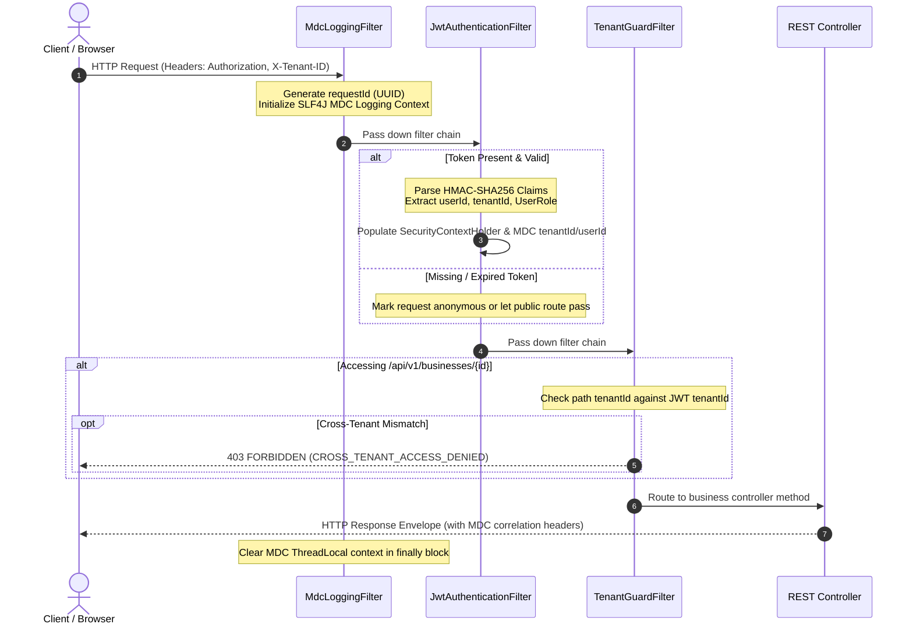
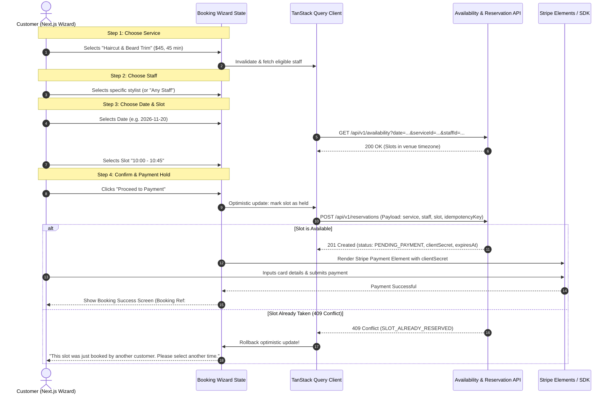
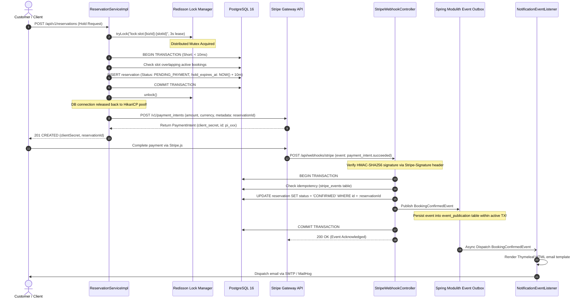
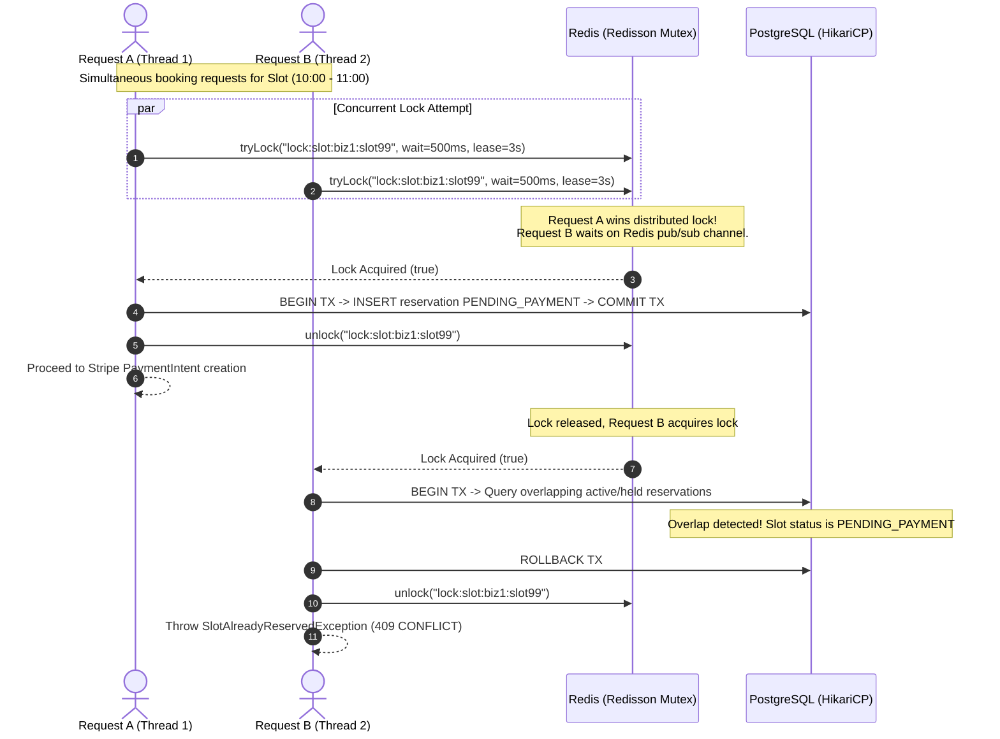
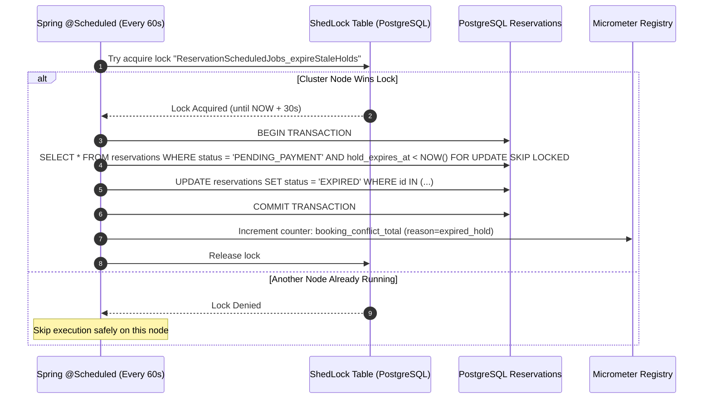
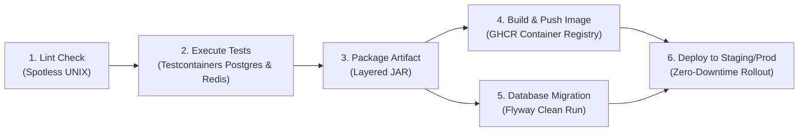

# Online Reservation System

[](https://github.com/istiakahasan/Online_Reservation_System/actions)
[](https://openjdk.org/projects/jdk/21/)
[](https://spring.io/projects/spring-boot)
[](https://spring.io/projects/spring-modulith)
[](https://www.postgresql.org/)
[](https://redis.io/)
[-black.svg)](https://nextjs.org/)
[](https://stripe.com/)
[](LICENSE)

> **Repository:** [https://github.com/istiakahasan/Online_Reservation_System](https://github.com/istiakahasan/Online_Reservation_System)  
> An enterprise-grade, high-concurrency, multi-tenant online reservation platform built as a **Modular Monolith** using Java 21 Virtual Threads, Spring Boot 3.3, Spring Modulith, PostgreSQL 16, Redis 7 (Redisson), Stripe SDK, and Next.js 14.

---

## Table of Contents

- [1. Executive Summary & Problem Statement](#1-executive-summary--problem-statement)
- [2. High-Level Project Architecture](#2-high-level-project-architecture)
- [3. Core Workflows & Sequence Diagrams](#3-core-workflows--sequence-diagrams)
  - [3.1 Multi-Tenant Request & Security Lifecycle](#31-multi-tenant-request--security-lifecycle)
  - [3.2 4-Step Customer Booking Wizard (Frontend to Backend)](#32-4-step-customer-booking-wizard-frontend-to-backend)
  - [3.3 Decoupled 2-Phase Hold & Stripe Payment Saga](#33-decoupled-2-phase-hold--stripe-payment-saga)
  - [3.4 High-Concurrency Double-Booking Prevention](#34-high-concurrency-double-booking-prevention)
  - [3.5 Distributed Stale Hold Expiration Sweeper](#35-distributed-stale-hold-expiration-sweeper)
- [4. Technology Stack Matrix](#4-technology-stack-matrix)
- [5. Project Directory Structure](#5-project-directory-structure)
- [6. Getting Started & Local Development](#6-getting-started--local-development)
  - [6.1 Prerequisites](#61-prerequisites)
  - [6.2 1-Command Startup via Docker Compose](#62-1-command-startup-via-docker-compose)
  - [6.3 Manual Backend Development Setup](#63-manual-backend-development-setup)
  - [6.4 Manual Frontend Development Setup](#64-manual-frontend-development-setup)
  - [6.5 Environment Configuration Reference](#65-environment-configuration-reference)
- [7. API Documentation & Interactive Swagger UI](#7-api-documentation--interactive-swagger-ui)
- [8. Observability, Telemetry & Monitoring](#8-observability-telemetry--monitoring)
  - [8.1 Health & Readiness Probes](#81-health--readiness-probes)
  - [8.2 Micrometer Custom Metrics](#82-micrometer-custom-metrics)
  - [8.3 OpenTelemetry Distributed Tracing & MDC Logging](#83-opentelemetry-distributed-tracing--mdc-logging)
  - [8.4 Grafana Dashboard](#84-grafana-dashboard)
- [9. Testing Strategy & Quality Assurance](#9-testing-strategy--quality-assurance)
- [10. CI/CD & Deployment Pipeline](#10-cicd--deployment-pipeline)
- [11. Architectural Governance & Deep Dives](#11-architectural-governance--deep-dives)
- [12. License & Contributing](#12-license--contributing)

---

## 1. Executive Summary & Problem Statement

Modern booking systems (restaurant tables, hotel rooms, salon appointments, medical consultations, and synchronized drop-window event ticketing) face a unique combination of engineering challenges:

1. **Extreme Burst Traffic Profiles ("Drop Windows"):** When coveted reservation slots drop at specific times (e.g. 09:00 AM daily), thousands of concurrent requests target the exact same inventory item simultaneously.
2. **Zero Double-Booking Guarantee:** The system must strictly enforce that no slot or staff member can ever be double-booked, even under millisecond race conditions.
3. **Database Connection Pool Starvation:** Third-party payment gateways (such as Stripe) incur unpredictable network latencies (200ms–2000ms). Wrapping external HTTP calls inside relational database transactions exhausts HikariCP pools, causing cascading service failure.
4. **Multi-Tenant Data Isolation:** Hundreds of discrete businesses operate on the shared platform; strict cross-tenant data isolation must be enforced without the massive infrastructure overhead of dedicated database instances per tenant.
5. **Operational Simplicity:** A small engineering team cannot justify the operational toll of distributed microservices (distributed sagas, network partition failures, multiple deployment pipelines, schema drift).

### How This Platform Solves Them

* **Modular Monolith Architecture (Spring Modulith):** Single deployable unit with strict compile-time and test-time architectural boundaries enforced via ArchUnit and Java package-private visibility.
* **Java 21 Virtual Threads:** High-throughput non-blocking I/O execution model capable of handling thousands of concurrent client requests per node.
* **Two-Tier Concurrency Defense:** Sub-millisecond distributed mutex locking via **Redisson** (`lock:slot:{businessId}:{slotId}`) backed by database-level PostgreSQL exclusion constraints.
* **Decoupled 2-Phase Hold Model:** Database transactions are kept under 10ms. **Zero external Stripe network I/O inside database transactions.** Slots are reserved in `PENDING_PAYMENT` holds; final confirmation occurs asynchronously via verified Stripe webhooks.
* **Event Publication Registry (Transactional Outbox):** Cross-module side effects (email confirmations, metrics aggregation) are persisted atomically inside the primary database transaction and dispatched asynchronously without requiring Kafka or RabbitMQ.

---

## 2. High-Level Project Architecture

The following diagram illustrates the overarching system architecture, from frontend clients through the security layer down to the modular domain boundaries, persistent data stores, and third-party integrations:

```mermaid
flowchart TD
    subgraph Clients["Clients Layer"]
        NextCustomer["Next.js 14 Customer Wizard<br/>/app/(customer)/book"]
        NextBusiness["Next.js 14 Business Portal<br/>/app/(business)/dashboard"]
        ExternalAPI["External API Consumers / Webhooks"]
    end

    subgraph SecurityGateway["Security & Context Gateway"]
        MdcFilter["MdcLoggingFilter<br/>(requestId, tenantId, userId)"]
        JwtFilter["JwtAuthenticationFilter<br/>(Stateless JWT Bearer Auth)"]
        TenantGuard["TenantGuardFilter<br/>(Cross-Tenant Access Barrier)"]
    end

    subgraph ModularMonolith["Spring Boot 3.3 Modular Monolith (Spring Modulith)"]
        subgraph CoreModules["Bounded Contexts (Package-by-Feature)"]
            AuthModule["Auth Module<br/>(Token Rotation, BCrypt)"]
            BusinessModule["Business Module<br/>(Tenants, Operating Hours, Timezones)"]
            UserModule["User Module<br/>(Customers, Staff, RBAC)"]
            ServiceModule["Service Module<br/>(Bookable Catalog, Buffers, Pricing)"]
            StaffModule["Staff Module<br/>(Rosters, Schedules, Assignments)"]
            AvailabilityModule["Availability Engine<br/>(Slot Computation, Redis Cache-Aside)"]
            ReservationModule["Reservation State Machine<br/>(2-Phase Holds, Cancellation Policies)"]
            PaymentModule["Payment Module<br/>(Stripe Sagas, Webhook Verification)"]
            NotificationModule["Notification Engine<br/>(Thymeleaf HTML Emails, MailHog)"]
        end

        EventOutbox[("Spring Modulith<br/>Event Publication Registry<br/>(Transactional Outbox)")]
        ShedLockJob["ShedLock Distributed Sweeper<br/>(Stale Hold Expiry Job)"]
    end

    subgraph DataStorage["Persistence & Distributed State"]
        PostgreSQL[("PostgreSQL 16<br/>ACID Source of Truth<br/>(Flyway Migrations)")]
        RedisStore[("Redis 7 (Redisson)<br/>- Distributed Mutex Locks<br/>- Availability Cache<br/>- Sliding-Window Rate Limiter")]
    end

    subgraph ThirdParty["External Services"]
        StripeGateway["Stripe API & Webhooks"]
        SMTPMail["SMTP Server / MailHog"]
        OtelCollector["OpenTelemetry Collector / Grafana"]
    end

    %% Client flows
    NextCustomer --> MdcFilter
    NextBusiness --> MdcFilter
    ExternalAPI --> MdcFilter

    %% Security chain
    MdcFilter --> JwtFilter
    JwtFilter --> TenantGuard
    TenantGuard --> CoreModules

    %% Inter-module and event flows
    ReservationModule -.->|Check Availability| AvailabilityModule
    ReservationModule -->|Persist Hold/Booking| PostgreSQL
    ReservationModule -->|Acquire Mutex Lock| RedisStore
    ReservationModule -->|Publish Domain Events| EventOutbox
    EventOutbox -.->|Async Dispatch| NotificationModule
    NotificationModule -->|Send Mail| SMTPMail

    %% Payment flows
    ReservationModule -->|Init PaymentIntent| PaymentModule
    PaymentModule -->|"Stripe REST API (No DB TX)"| StripeGateway
    StripeGateway -.->|Signed Webhook Event| PaymentModule

    %% Caching & Background jobs
    AvailabilityModule -->|Read/Write Slot Cache| RedisStore
    AvailabilityModule -->|Read Rosters & Rules| PostgreSQL
    ShedLockJob -->|Claim Cluster Lock| PostgreSQL
    ShedLockJob -->|Expire Stale Holds| ReservationModule

    %% Observability
    ModularMonolith -.->|OTLP Traces & Prometheus Metrics| OtelCollector
```



---

## 3. Core Workflows & Sequence Diagrams

### 3.1 Multi-Tenant Request & Security Lifecycle

Every inbound HTTP request undergoes tenant resolution, JWT signature verification, and MDC correlation tracking before invoking controller logic.



---

### 3.2 4-Step Customer Booking Wizard (Frontend to Backend)

The Next.js customer booking wizard (`/app/(customer)/book`) guides the user through 4 reactive steps backed by TanStack Query v5 with optimistic updates and graceful 409 conflict rollbacks.



---

### 3.3 Decoupled 2-Phase Hold & Stripe Payment Saga

To guarantee that **zero third-party network I/O takes place inside database transactions**, the reservation lifecycle uses a decoupled 2-phase hold pattern.



---

### 3.4 High-Concurrency Double-Booking Prevention

During high-demand slot drops, hundreds of concurrent requests contend for the same slot. The two-tier locking architecture ensures zero double bookings without exhausting database connections.



---

### 3.5 Distributed Stale Hold Expiration Sweeper

If a user abandons checkout after initiating a hold, the reservation would permanently block the slot without an automated expiration sweeper. A distributed scheduled job safely sweeps expired holds across all horizontal cluster nodes.



---

## 4. Technology Stack Matrix

| Layer / Concern | Technology | Version | Purpose & Rationale |
| :--- | :--- | :--- | :--- |
| **Language & Platform** | [Java (OpenJDK)](https://openjdk.org/projects/jdk/21/) | 21 LTS | Pattern matching, records, sealed interfaces, and **Virtual Threads** (`spring.threads.virtual.enabled=true`). |
| **Framework** | [Spring Boot](https://spring.io/projects/spring-boot) | 3.3.5 | Core inversion-of-control, autoconfiguration, Actuator, and embedded web runtime. |
| **Architecture Enforcer** | [Spring Modulith](https://spring.io/projects/spring-modulith) | 1.2.4 | Enforces bounded contexts, architectural verification via ArchUnit, and provides the Transactional Event Outbox. |
| **Primary Database** | [PostgreSQL](https://www.postgresql.org/) | 16-alpine | Single source of truth with full ACID compliance, row-level locking, and exclusion constraints. |
| **Database Migrations** | [Flyway](https://flywaydb.org/) | 10.10.0 | Versioned, reproducible SQL migrations (`V1` through `V5`) executed automatically on application startup. |
| **Distributed Caching & Locks**| [Redis](https://redis.io/) & [Redisson](https://redisson.org/) | 7-alpine / 3.37.0 | Distributed mutex locks (`RLock`), slot availability cache-aside, and rate-limiting storage. |
| **Distributed Job Scheduling** | [ShedLock](https://github.com/lukas-krecan/ShedLock) | 5.16.0 | Cluster-safe scheduled jobs using JDBC table locking to ensure single execution across replicas. |
| **Security & Authentication** | Spring Security & [JJWT](https://github.com/jwtk/jjwt) | 0.12.6 | Stateless JWT authentication (HMAC-SHA256), short-lived access tokens (15m), and refresh token rotation (7d). |
| **Payments Integration** | [Stripe Java SDK](https://github.com/stripe/stripe-java) | 28.0.0 | Decoupled PaymentIntent generation, client-side Elements integration, and secure webhook signature verification. |
| **Templating & Notifications**| Thymeleaf & Spring Mail | 3.3.5 | Rich HTML email template rendering dispatched asynchronously via SMTP / MailHog. |
| **Observability & Metrics** | Micrometer & Prometheus | 1.13.x | Custom business counters, availability latency timers, and `/actuator/prometheus` scraping endpoint. |
| **Distributed Tracing** | OpenTelemetry (OTel) | 1.34.x | W3C distributed trace propagation across Controller -> Service -> Repository with OTLP export. |
| **API Documentation** | [SpringDoc OpenAPI](https://springdoc.org/) | 2.6.0 | Swagger UI 3 and automated OpenAPI 3.0.1 specification generation. |
| **Frontend Framework** | [Next.js (App Router)](https://nextjs.org/) | 14.x | Server-rendered and client-reactive wizard pages, route groups `(customer)` and `(business)`. |
| **Client Data Fetching** | [TanStack Query](https://tanstack.com/query) | v5 | React query hooks with optimistic UI mutations, automatic caching, and conflict rollback. |
| **Containerization** | Docker & Docker Compose | Multi-Stage | Minimal Eclipse Temurin JRE 21 runtime container, non-root user (`appuser:appgroup`), layered jar build. |
| **Integration Testing** | [Testcontainers](https://testcontainers.com/) | 1.19.8 | Ephemeral PostgreSQL 16 and Redis containers for fully reproducible, environment-independent integration tests. |

---

## 5. Project Directory Structure

```text
Online_Reservation_System/
├── .github/
│   └── workflows/
│       └── ci-cd.yml                     # GitHub Actions CI/CD Pipeline
├── app/                                  # Next.js 14 App Router
│   ├── (business)/
│   │   └── dashboard/page.tsx            # Business management portal
│   ├── (customer)/
│   │   └── book/
│   │       ├── components/               # 4-Step Wizard components (Service, Staff, Slot, Confirm)
│   │       ├── booking-context.tsx       # React Context provider & state machine
│   │       ├── booking-wizard.css        # Responsive, mobile-first design styles
│   │       └── page.tsx                  # Public customer booking entry point
│   └── layout.tsx                        # Root layout with TanStack Query provider
├── docs/
│   ├── adr/
│   │   └── ADR-001-core-architecture.md  # Core Architecture Decision Record
│   ├── openapi/
│   │   ├── openapi.json                  # OpenAPI 3 specification (JSON)
│   │   └── openapi.yaml                  # OpenAPI 3 specification (YAML)
│   ├── RUNBOOK.md                        # Production Deployment & Incident Runbook
│   └── TEST_PLAN.md                      # Comprehensive Backend Test Plan
├── frontend/
│   └── lib/
│       ├── api/                          # Auto-generated TypeScript API client
│       │   ├── endpoints/                # Modular endpoint clients (auth, availability, reservations)
│       │   └── types.ts                  # Type-safe request/response interfaces
│       ├── auth/                         # JWT storage & transparent 401 refresh interceptor
│       └── hooks/                        # TanStack Query custom hooks
├── grafana/
│   └── grafana-dashboard.json            # Pre-configured Grafana metrics dashboard
├── src/
│   ├── main/
│   │   ├── java/com/example/reservation/
│   │   │   ├── auth/                     # Bounded Context: JWT Authentication & Refresh
│   │   │   ├── availability/             # Bounded Context: Slot Engine & Redis Cache-Aside
│   │   │   ├── business/                 # Bounded Context: Tenant Profiles, Hours & Timezones
│   │   │   ├── notification/             # Bounded Context: Async Event Listeners & Email Templates
│   │   │   ├── payment/                  # Bounded Context: Stripe PaymentIntents & Webhooks
│   │   │   ├── reservation/              # Bounded Context: Booking State Machine & Policy Engine
│   │   │   ├── service/                  # Bounded Context: Bookable Services Catalog
│   │   │   ├── staff/                    # Bounded Context: Staff Profiles & Working Hours
│   │   │   ├── user/                     # Bounded Context: User Management & RBAC Roles
│   │   │   └── shared/                   # Cross-Cutting: Security, Exceptions, MDC, Metrics
│   │   └── resources/
│   │       ├── db/migration/             # Versioned Flyway SQL scripts (V1 through V5)
│   │       ├── templates/email/          # Thymeleaf HTML notification email templates
│   │       └── application.yaml          # Application configuration properties
│   └── test/                             # Unit, Integration, Concurrency, and Security Tests
├── .env.example                          # Fully documented environment variable template
├── ARCHITECTURE.md                       # Deep-Dive System Architecture Specification
├── docker-compose.yml                    # Multi-container orchestration (App, DB, Redis, MailHog, Stripe)
├── Dockerfile                            # Optimized multi-stage layered container build
├── pom.xml                               # Maven project configuration & dependencies
└── Project standards.md                  # Strict engineering guidelines & coding standards
```

---

## 6. Getting Started & Local Development

### 6.1 Prerequisites

Ensure you have the following installed on your host workstation:
* **Java Development Kit (JDK):** [Java 21 LTS](https://adoptium.net/temurin/releases/?version=21)
* **Docker & Docker Compose:** [Docker Desktop](https://www.docker.com/products/docker-desktop/) or Docker Engine 24+
* **Node.js & npm:** [Node.js 18 LTS+](https://nodejs.org/) (for frontend development)

### 6.2 1-Command Startup via Docker Compose

The fastest way to launch the complete local environment (PostgreSQL 16, Redis 7, MailHog SMTP, Stripe Mock Server, and the layered Spring Boot application) is via Docker Compose:

```bash
# 1. Clone the repository
git clone https://github.com/istiakahasan/Online_Reservation_System.git
cd Online_Reservation_System

# 2. Copy the environment configuration template
cp .env.example .env

# 3. Spin up the entire infrastructure stack in detached mode
docker compose up -d --build
```

#### Verifying Services

Once all containers report healthy, access the following endpoints:

| Service | Host URL | Description |
| :--- | :--- | :--- |
| **Spring Boot Application** | [http://localhost:8080](http://localhost:8080) | Core backend REST API |
| **Interactive Swagger UI** | [http://localhost:8080/swagger-ui.html](http://localhost:8080/swagger-ui.html) | OpenAPI 3.0 API Documentation |
| **Actuator Health Probe** | [http://localhost:8080/health](http://localhost:8080/health) | Liveness probe (`UP`) |
| **Actuator Readiness Probe** | [http://localhost:8080/ready](http://localhost:8080/ready) | Readiness probe (DB + Redis + Stripe) |
| **Prometheus Metrics** | [http://localhost:8080/actuator/prometheus](http://localhost:8080/actuator/prometheus) | Prometheus scrape target |
| **MailHog Web Mailbox** | [http://localhost:8025](http://localhost:8025) | Local UI for inspecting confirmation emails |
| **Stripe Mock Server** | [http://localhost:12111](http://localhost:12111) | Local Stripe API mock |

To stop the container stack:
```bash
docker compose down
```

---

### 6.3 Manual Backend Development Setup

If you prefer running the Spring Boot application locally inside your IDE (e.g. IntelliJ IDEA, VS Code) while keeping support services in Docker:

1. **Start only the infrastructure containers:**
   ```bash
   docker compose up -d postgres redis mailhog stripe-mock
   ```

2. **Verify database connectivity and apply Flyway migrations:**
   ```bash
   # On Linux/macOS:
   ./mvnw compile

   # On Windows:
   .\mvnw.cmd compile
   ```

3. **Run the Spring Boot application:**
   ```bash
   # On Linux/macOS:
   ./mvnw spring-boot:run

   # On Windows:
   .\mvnw.cmd spring-boot:run
   ```

The application will bind to port `8080` with Virtual Threads enabled.

---

### 6.4 Manual Frontend Development Setup

The frontend customer booking wizard and business management portal run on Next.js 14:

```bash
# 1. Install frontend npm dependencies
npm install

# 2. Start the Next.js development server
npm run dev
```

Visit [http://localhost:3000/app/(customer)/book](http://localhost:3000) to interact with the responsive 4-step booking wizard.

---

### 6.5 Environment Configuration Reference

All configurable options are documented in [.env.example](file:///.env.example). Key environment variables include:

| Environment Variable | Default Value | Description |
| :--- | :--- | :--- |
| `SERVER_PORT` | `8080` | Port on which the Spring Boot application listens |
| `SPRING_PROFILES_ACTIVE` | `prod` / `local` | Active Spring profile |
| `DB_HOST` / `DB_PORT` | `postgres` / `5432` | PostgreSQL host and port |
| `DB_NAME` | `reservation_db` | Primary application database name |
| `DB_USERNAME` / `DB_PASSWORD` | `postgres` / `postgres` | Database credentials |
| `REDIS_HOST` / `REDIS_PORT` | `redis` / `6379` | Redis host and port |
| `REDISSON_ADDRESS` | `redis://redis:6379` | Redisson connection string |
| `JWT_SECRET` | *(256-bit string)* | HMAC-SHA256 signing secret key |
| `JWT_ACCESS_EXPIRATION_MINUTES`| `15` | Short-lived access token TTL |
| `JWT_REFRESH_EXPIRATION_DAYS` | `7` | Refresh token whitelist TTL |
| `STRIPE_API_KEY` | `sk_test_...` | Stripe secret API key |
| `STRIPE_WEBHOOK_SECRET` | `whsec_...` | Stripe webhook signing secret |
| `STRIPE_BASE_URL` | `http://stripe-mock:12111` | Stripe endpoint (points to mock locally) |
| `MAIL_HOST` / `MAIL_PORT` | `mailhog` / `1025` | SMTP host and port |
| `OTEL_EXPORTER_OTLP_ENDPOINT` | `http://localhost:4318/v1/traces` | OpenTelemetry collector trace endpoint |

---

## 7. API Documentation & Interactive Swagger UI

The platform provides complete OpenAPI 3.0 documentation generated dynamically via SpringDoc.

* **Interactive Swagger UI:** [http://localhost:8080/swagger-ui.html](http://localhost:8080/swagger-ui.html)
* **Raw OpenAPI Spec (YAML):** [docs/openapi/openapi.yaml](file:///docs/openapi/openapi.yaml)
* **Raw OpenAPI Spec (JSON):** [docs/openapi/openapi.json](file:///docs/openapi/openapi.json)

### Key Endpoint Catalog

| HTTP Method | Path | Summary & Description | Security / Role |
| :--- | :--- | :--- | :--- |
| `POST` | `/api/v1/auth/register` | Register new customer or staff account | Public |
| `POST` | `/api/v1/auth/login` | Authenticate with credentials and receive JWT pair | Public |
| `POST` | `/api/v1/auth/refresh` | Exchange valid refresh token for fresh access token | Public |
| `GET` | `/api/v1/businesses/{id}` | Retrieve business profile, timezone, and hours | Authenticated |
| `GET` | `/api/v1/services` | List bookable services for a business | Authenticated |
| `GET` | `/api/v1/staff` | List staff members assigned to a service | Authenticated |
| `GET` | `/api/v1/availability` | Calculate available time slots for date, service, & staff | Authenticated |
| `POST` | `/api/v1/reservations` | Initiate slot hold & generate Stripe PaymentIntent | Authenticated |
| `GET` | `/api/v1/reservations/{id}` | Retrieve reservation details & state | Authenticated (Tenant Owner/Customer) |
| `POST` | `/api/v1/reservations/{id}/cancel` | Cancel booking & execute policy-based refund | Authenticated |
| `POST` | `/api/webhooks/stripe` | Stripe webhook event receiver (HMAC verified) | Public (Stripe Signature) |
| `GET` | `/health` | Actuator liveness probe | Public |
| `GET` | `/ready` | Actuator readiness probe (DB + Redis + Stripe) | Public |
| `GET` | `/actuator/prometheus` | Prometheus metrics scrape endpoint | Public / Internal |

---

## 8. Observability, Telemetry & Monitoring

### 8.1 Health & Readiness Probes

The application exposes Kubernetes-compliant health probes configured in [HealthCheckController.java](file:///src/main/java/com/example/reservation/shared/observability/HealthCheckController.java):

* **Liveness (`/health`):** Returns `200 OK {"status": "UP", "probe": "liveness"}` indicating the JVM is active and responsive.
* **Readiness (`/ready`):** Actively checks connectivity to PostgreSQL (via `SELECT 1`), Redis (via `ping()`), and Stripe (via [StripeHealthIndicator.java](file:///src/main/java/com/example/reservation/shared/observability/StripeHealthIndicator.java)). If any dependency fails, it returns `503 SERVICE_UNAVAILABLE {"status": "DOWN"}`.

### 8.2 Micrometer Custom Metrics

Business metrics are captured via Micrometer and exposed for Prometheus scraping:

* **`booking_success_total` (Counter):** Counts successfully confirmed reservations tagged by `business_id` and `service_id`.
* **`booking_conflict_total` (Counter):** Tracks slot collision attempts and rejected double-bookings tagged by `reason` (`lock_contention`, `db_constraint`, `expired_hold`).
* **`payment_failure_total` (Counter):** Records failed Stripe payment attempts tagged by `failure_code`.
* **`availability_latency` (Timer):** Records the latency histogram (p50, p95, p99) of slot calculation queries.
* **`active_reservations` (Gauge):** Tracks currently held and active reservations in the system.

### 8.3 OpenTelemetry Distributed Tracing & MDC Logging

Every log line is enriched via [MdcLoggingFilter.java](file:///src/main/java/com/example/reservation/shared/observability/MdcLoggingFilter.java) with contextual correlation tokens:

```text
2026-11-16 12:45:10.124 [http-nio-8080-exec-1] INFO  [req=7f2c8d20-11fa-4f9e] [tenant=b3e7a102-99c0-4321] [user=c90a1b24-8841-47fe] [trace=4bf92f3577b34da6a3ce929d0e0e4736,span=00f067aa0ba902b7] c.e.r.reservation.service.ReservationServiceImpl - Successfully created PENDING_PAYMENT hold for slot 10:00-11:00
```

* Distributed traces span automatically across **Controller → Service → Repository** layers via `micrometer-tracing-bridge-otel` and export directly to any OTLP-compatible collector (Jaeger, Tempo, Grafana Agent).

### 8.4 Grafana Dashboard

A pre-built production Grafana dashboard is included at [grafana/grafana-dashboard.json](file:///grafana/grafana-dashboard.json). It provides real-time visualization of:
1. Booking throughput & conflict rates
2. P95 and P99 availability calculation latencies
3. Active database connection pool usage (HikariCP)
4. Redis cache hit/miss ratios and lock lease durations
5. Stripe payment success vs failure breakdown

---

## 9. Testing Strategy & Quality Assurance

The project enforces a comprehensive, multi-layer testing strategy covering unit, integration, concurrency, security, and end-to-end flows. Detailed test documentation is available in [docs/TEST_PLAN.md](file:///docs/TEST_PLAN.md).

```text
Test Suite Coverage:
├── Unit Tests
│   ├── AvailabilityEngineTest           # Verifies slot generation, operating hours, and buffer times
│   ├── ReservationStateMachineTest       # Verifies state transitions (PENDING -> CONFIRMED -> CANCELLED)
│   └── CancellationPolicyTest            # Verifies Full, Partial (50%), No Refund, and Window policies
├── Integration Tests (Testcontainers)
│   ├── ReservationConcurrencyIntegrationTest  # 20-thread race condition on a single slot
│   ├── ShedLockConcurrencyIntegrationTest     # Multi-instance distributed lock validation
│   └── StripeWebhookControllerTest            # Valid signature & replay attack verification
├── Security Tests
│   ├── SecurityIntegrationTest                # Cross-tenant 403 barriers, JWT tampering, and SQLi probes
│   └── AuthControllerTest                     # Token issuance, refresh rotation, and invalid payload rejection
├── E2E Tests (Playwright)
│   └── e2e/booking-wizard.spec.ts             # Complete 4-step wizard happy path & conflict rollback
└── Load Tests (Gatling)
    └── load-tests/                            # 100 concurrent virtual users simulating slot drop bursts
```

### Running Tests Locally

```bash
# Run unit and security tests:
./mvnw test

# Run code style and formatting verification:
./mvnw spotless:check

# Auto-format codebase:
./mvnw spotless:apply

# Run Playwright E2E tests:
npx playwright test
```

---

## 10. CI/CD & Deployment Pipeline

Every commit pushed to `main` or `dev` triggers the automated GitHub Actions workflow defined in [.github/workflows/ci-cd.yml](file:///.github/workflows/ci-cd.yml):



1. **Lint Job:** Verifies strict Java formatting rules using Spotless.
2. **Test Job:** Spins up ephemeral PostgreSQL 16 and Redis Testcontainers to execute unit, integration, and security suites.
3. **Package Job:** Packages the Spring Boot application and extracts layered JAR layers.
4. **Docker Job:** Builds the minimal JRE 21 multi-stage container and publishes it to GitHub Container Registry (GHCR).
5. **Flyway Migration Job:** Executes idempotent database migrations before application deployment.
6. **Deployment Job:** Triggers zero-downtime rolling container restart.

For incident response playbooks, rollback steps, and zero-downtime database migration guidelines, consult the [Production Runbook (docs/RUNBOOK.md)](file:///docs/RUNBOOK.md).

---

## 11. Architectural Governance & Deep Dives

For in-depth architectural specifications and governance policies, explore the companion documentation:

* 📘 [ARCHITECTURE.md](file:///ARCHITECTURE.md): Deep-dive architectural specification detailing module boundaries, concurrency models, transactional outbox design, and multi-tenancy mechanics.
* 📄 [ADR-001: Core Architecture, Modularity, and Concurrency](file:///docs/adr/ADR-001-core-architecture.md): Formal Architecture Decision Record detailing trade-offs and rejected alternatives.
* 📋 [docs/TEST_PLAN.md](file:///docs/TEST_PLAN.md): Detailed backend testing plan and checklist.
* 🚨 [docs/RUNBOOK.md](file:///docs/RUNBOOK.md): Deployment checklist, zero-downtime Flyway procedures, and incident recovery playbooks.
* 📐 [Project standards.md](file:///Project%20standards.md): Mandatory engineering standards, package-by-feature layout, and coding rules.

---

## 12. License & Contributing

Distributed under the Apache 2.0 License. See `LICENSE` for more information.

Contributions, bug reports, and feature requests are welcome! Please open an issue or pull request against the `dev` branch on the official repository:  
👉 **[https://github.com/istiakahasan/Online_Reservation_System](https://github.com/istiakahasan/Online_Reservation_System)**
